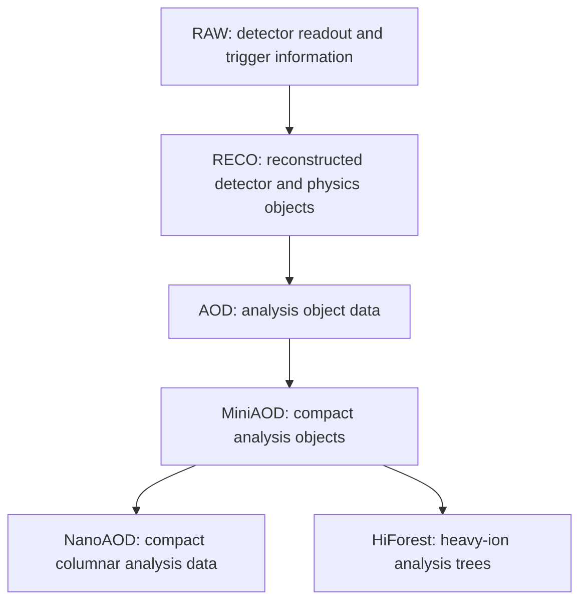
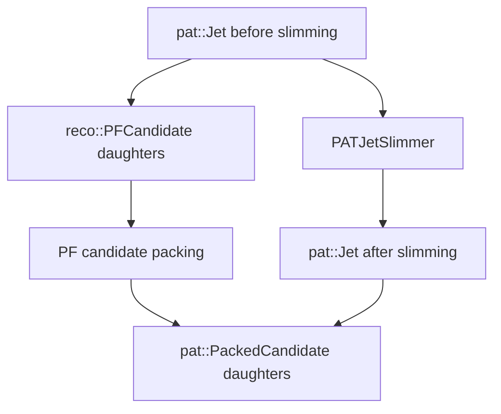

# CMS MiniAOD

MiniAOD (MINIAOD for collision data, MINIAODSIM for simulated data) is a centrally produced CMS analysis data tier. It is a compact representation of reconstructed collision events, retaining high-level physics objects and enough lower-level information to support many analysis-specific operations.

It is not a list of the actual particles created in the collision, nor a flat ntuple of kinematic variables. It contains **typed C++ event products**, serialized in ROOT according to the CMS Event Data Model (EDM).

## Position in the CMS data flow



This diagram illustrates the conceptual reduction of information, not a mandatory sequence of separately persisted intermediate files. Production workflows can combine reconstruction and slimming.

| Tier | Main information |
| --- | --- |
| RAW | Encoded detector measurements and trigger information. |
| RECO | Detailed reconstructed objects, including detector-level reconstruction products. |
| AOD | Reduced reconstructed information suitable for physics analysis, retaining more detail than MiniAOD. |
| MiniAOD | Compact physics objects, particle-flow candidates, vertices, trigger and auxiliary information; generator information in simulation. |
| NanoAOD | Selected analysis variables in a simpler columnar ROOT layout, normally readable without CMSSW object dictionaries. |
| HiForest | Heavy-ion-specific derived analysis trees; content depends on the production configuration. |

The original MiniAOD design targeted roughly one tenth of Run 1 AOD storage (about 400 kB/event for that AOD reference). The CMS DAS documentation gives 30–50 kB/event as a historical MiniAOD design scale. These are not measurements of Run 3 PbPb files: event size depends on occupancy, era, campaign and retained content.

## How MiniAOD is stored: the EDM

A MiniAOD ROOT file has an `Events` TTree containing serialized EDM products, along with separate run- and luminosity-block-level information and metadata/provenance. Each event can contain many products, such as a collection of reconstructed muons, a collection of jets, or a trigger decision object.

A product is identified by four quantities:

| Identifier | Example |
| --- | --- |
| C++ type | `std::vector<pat::Muon>` |
| Module label | `slimmedMuons` |
| Product instance label | Empty string for the default instance |
| Process name | Depends on the production history |

An `edm::InputTag` specifies the label, instance and process; the requested C++ type is specified separately. For example, `edm::InputTag("slimmedMuons")` with a token for `std::vector<pat::Muon>` requests the corresponding collection using CMSSW's process resolution rules.

Conceptually, the event contains:

```text
Event
  identity: run, luminosity block, event number
  slimmedMuons:      vector<pat::Muon>
  slimmedElectrons:  vector<pat::Electron>
  slimmedJets:      vector<pat::Jet>
  packedPFCandidates: vector<pat::PackedCandidate>
  ...
```

This is a conceptual view, not the literal layout of ROOT branches. EDM products can refer to other products through persistent references such as `edm::Ptr` and `edm::Ref`. ROOT serialization may split object members into subbranches. Reading the file with ROOT alone is possible for inspection, but using the C++ objects and resolving their references normally requires compatible CMSSW dictionaries and software.

## What is stored?

The following are representative product labels from the release-specific MiniAOD event content in CMSSW_13_2_4; they are not a claim that every listed product exists in every dataset.

### High-level reconstructed physics objects

Many physics objects use Physics Analysis Toolkit (PAT) classes in the `pat` namespace, which build on CMS reconstructed-object classes and provide analysis-oriented quantities and associations.

| Module label | Typical element type | Information |
| --- | --- | --- |
| `slimmedMuons` | `pat::Muon` | Kinematics, charge, identification, isolation and retained track information |
| `slimmedElectrons` | `pat::Electron` | Kinematics, charge, electromagnetic shower and track properties, identification |
| `slimmedPhotons` | `pat::Photon` | Kinematics, shower shapes, isolation |
| `slimmedTaus` | `pat::Tau` | Reconstructed hadronic tau candidates and discriminators |
| `slimmedJets` | `pat::Jet` | Jet kinematics, correction information, composition and retained constituent links |
| `slimmedJetsAK8` | `pat::Jet` | Large-radius jets and retained substructure information |
| `slimmedMETs` | `pat::MET` | Missing transverse momentum and related quantities |

Other collections and variants (e.g. PUPPI) can coexist. Jet algorithms, selection thresholds, correction conventions and embedded information depend on the production configuration. A stored object does not necessarily pass the final analysis identification or calibration requirements.

### Particle-flow candidates and tracks

Particle Flow (PF) combines information from tracking, calorimetry and muon systems to reconstruct individual particle candidates, such as charged hadrons, neutral hadrons, photons, electrons and muons.

MiniAOD stores a compact collection of these candidates in `packedPFCandidates` (`std::vector<pat::PackedCandidate>`). It retains approximate four-momentum, particle type, charge, vertex association and selected track information for charged candidates. The packing uses reduced precision for some quantities and does not retain all original reconstruction information.

`lostTracks` stores additional selected tracks not represented by the regular packed PF candidates, also in packed-candidate form. Some packed candidates have enough retained track parameters to construct a pseudo-track, which is not equivalent to recovering the full original track and hit collection.

The candidate collections are useful for recomputing isolation, reclustering jets, calculating jet substructure and studying the underlying event, subject to the information retained and the relevant reconstruction conventions.

A PF candidate may also be associated with a high-level lepton or form part of a jet. These are different representations of the same reconstructed event, not disjoint particle lists to be summed indiscriminately.

### Event and detector information

- `offlineSlimmedPrimaryVertices`: reconstructed interaction vertices.
- `offlineBeamSpot`: estimated beam interaction region.
- `fixedGridRhoFastjetAll` and related products: energy-density estimates.
- `TriggerResults`: trigger and other path decisions; distinguish them by process.
- `slimmedPatTrigger` and `patTrigger`: retained trigger objects and prescale information.
- `reducedEgamma`: selected electromagnetic calorimeter clusters, hits, conversion and track information.

MiniAOD does not retain the full detector readout or every intermediate reconstruction product. Some detector-level information is retained selectively.

### Heavy-ion-specific content

The `pp_on_AA` process modifier adds heavy-ion-specific keep rules in CMSSW_13_2_4. Examples include:

| Product label | Purpose |
| --- | --- |
| `hiCentrality`, `centralityBin` | Centrality observables and bin information |
| `hiHFfilters`, `hiClusterCompatibility` | Collision selection inputs |
| `hiEvtPlane`, `hiEvtPlaneFlat` | Event-plane information |
| `hiPixelTracks` | Packed pixel track candidates |
| `packedPFCandidatesRemoved` | Additional packed candidates removed in the standard HI preparation |
| `packedPFCandidateTrackChi2`, `lostTrackChi2` | Auxiliary track fit information |
| `hcalDigis:ZDC` | ZDC digis |

The exact contents of a particular 2023 PbPb dataset must be verified with `edmDumpEventContent`. The keep rules describe what can be retained, not proof that every product was produced.

### Additional information in MINIAODSIM

Simulated events can additionally retain:

| Product label | Information |
| --- | --- |
| `prunedGenParticles` | Selected generator particles and ancestry, including hard-process particles |
| `packedGenParticles` | Compact stable generator-particle representation |
| `slimmedGenJets`, `slimmedGenJetsAK8` | Particle-level generator jets |
| `generator` | Generator event information, including weights where applicable |
| `externalLHEProducer` (when present) | LHE information, including event weights |
| `slimmedAddPileupInfo` | Pileup summary information where applicable |
| `packedGenParticlesSignal`, `heavyIon` | Additional heavy-ion MC information retained by the HI modifier |

The pruned and packed generator collections are complementary, not complete copies of the original generator record. Reconstructed and generator objects may have retained matching associations; their availability and semantics are configuration-dependent. In heavy-ion MC, whether generator-level objects represent a quenched or unquenched reference depends on the generator and embedding workflow, not on the file tier.

## What makes MiniAOD smaller?

MiniAOD achieves its reduction through several techniques:

- Dropping collections not commonly needed for downstream analysis.
- Slimming individual objects and retaining selected associated information.
- Packing low-level candidates and reducing numerical precision where acceptable.
- Applying object-level storage thresholds.

This is primarily a reduction in information per event, distinct from skimming, which selects a subset of events. The loss of information is deliberate and generally irreversible.

### What does `slimmed*` mean?

Slimming reduces the information retained within a reconstructed object and its associated products, without introducing a new C++ class. For example, both `selectedPatMuons` and `slimmedMuons` contain `std::vector<pat::Muon>`. The latter is produced by a dedicated slimmer that copies and modifies the input objects.

| Technique | What is reduced |
| --- | --- |
| Skimming | Number of events |
| Object selection | Number of objects within an event or collection |
| Slimming | Detail retained in individual objects and their associations |
| Packing | Storage size of retained quantities, sometimes through reduced precision |
| Dropping | Entire event products |

These techniques can overlap: a slimmer may also reduce numerical precision or selectively retain associated products.

#### Muon slimming

The reference [PATMuonSlimmer configuration](https://github.com/cms-sw/cmssw/blob/CMSSW_13_2_4/PhysicsTools/PatAlgos/python/slimming/slimmedMuons_cfi.py) takes `selectedPatMuons` and produces `slimmedMuons`. Its [C++ implementation](https://github.com/cms-sw/cmssw/blob/CMSSW_13_2_4/PhysicsTools/PatAlgos/plugins/PATMuonSlimmer.cc) copies each input muon before applying the configured transformations.

Examples from CMSSW_13_2_4:

- The main muon kinematics, charge and standard isolation information are retained.
- The redundant PF four-momentum is removed from PF muons (`dropPfP4 = "1"`), not the main muon four-momentum.
- Selected calorimeter quantities are stored with reduced mantissa precision (`slimCaloVars = "1"`).
- Track-extra references are remapped to retained collections where available, and the original-object reference is redirected to the associated packed PF candidate or lost track where applicable.
- Dedicated high-momentum track fits are embedded for muons with `pt > 100` GeV; the configured selection for saving DT/CSC segments is `pt > 50` GeV.

#### Jet slimming and constituent references

The reference [PATJetSlimmer configuration](https://github.com/cms-sw/cmssw/blob/CMSSW_13_2_4/PhysicsTools/PatAlgos/python/slimming/slimmedJets_cfi.py) takes `selectedPatJets` and produces `slimmedJets`, both collections of `pat::Jet`.

```python
dropJetVars = cms.string("1"),
dropDaughters = cms.string("0"),
rekeyDaughters = cms.string("1"),
dropTrackRefs = cms.string("1"),
dropSpecific = cms.string("0"),
dropTagInfos = cms.string("1"),
```

In this configuration, jet daughters are retained but their references are rekeyed to the compact packed PF candidate collection. Explicit track references and the configured jet variables and tag-info payloads are dropped. Dropping tag-info payloads does not imply that all stored tagging discriminator values are dropped.



This is particularly useful for jet substructure: retained constituent associations allow access to compact reconstructed constituent kinematics without storing the full original PF reconstruction objects. Reclustering or recomputing observables remains possible within the limitations of the stored inputs.

#### Implications for analysis

The C++ interface is preserved, but the information content is reduced. Methods such as `muon.pt()`, `muon.innerTrack()`, `jet.numberOfDaughters()` and `jet.daughter(i)` remain part of their respective classes. The presence of a method does not guarantee that its underlying information was retained or that a returned reference can be dereferenced. Check reference availability and the production configuration before relying on it.

These are examples from the reference CMSSW_13_2_4 slimming configuration. Era and process modifiers, object-specific settings and the actual production campaign can change the retained information; the precise content of individual PbPb input files has not yet been independently verified.

## How HiForest uses MiniAOD

HiForest runs within [[Computing/CMSSW|CMSSW]] and reads EDM products through configured input tags. It can also run additional producers before writing its output.

For example, the 2023 PbPb configuration reads packed PF candidates for heavy-ion jet processing and uses slimmed leptons as inputs to additional correction and identification modules. The analyzers then write selected observables into ordinary ROOT TTrees.

| MiniAOD input / intermediate products | Example HiForest output |
| --- | --- |
| `slimmedMuons` and derived muon products | `ggHiNtuplizer/EventTree`: `muPt`, `muEta`, `muPhi`, etc. |
| Packed PF candidates and reconstructed jet products | `akCs4PFJetAnalyzer/t`, `akCs4FlowPFJetAnalyzer/t` |
| `hiCentrality` and event products | `hiEvtAnalyzer/HiTree` |
| Trigger results | `hltanalysis/HltTree` |
| Generator particle and jet products | MC truth and matching branches |

MiniAOD is therefore a richer, reusable input for analysis-specific reconstruction, while HiForest is a derived representation convenient for repeated statistical analysis. Neither format allows recovery of information already discarded upstream.

See [[Computing/HiForest Setup|HiForest Setup]] for a working production environment.

## Inspect a real MiniAOD file

With a compatible CMSSW runtime initialized and an authorized file URL or local filename:

```bash
INPUT="path-or-xrootd-url-to-miniaod.root"

edmDumpEventContent "$INPUT"
edmDumpEventContent "$INPUT" | grep -E 'slimmedMuons|packedPFCandidates|hiCentrality|GenParticles'
edmProvDump "$INPUT"
edmEventSize -v "$INPUT"
```

The commands inspect available products, process provenance and event-product storage respectively. They are more informative than merely listing ROOT keys, because they understand the EDM.

For a simple interactive inspection with Python and FWLite:

```python
from DataFormats.FWLite import Events, Handle

events = Events("path-or-xrootd-url-to-miniaod.root")
muons = Handle("std::vector<pat::Muon>")

for event in events:
    event.getByLabel("slimmedMuons", muons)
    if muons.isValid():
        for mu in muons.product():
            print(mu.pt(), mu.eta(), mu.phi(), mu.charge())
    break
```

Unlike reading a HiForest branch containing a vector of numbers, this accesses the methods of actual CMS C++ physics objects. FWLite requires the compatible CMSSW runtime. The snippet is illustrative; it has not been executed against the local PbPb files.

## References

- G. Petrucciani, A. Rizzi, C. Vuosalo, [Mini-AOD: A New Analysis Data Format for CMS](https://arxiv.org/abs/1702.04685).
- [CMS Open Data: Getting Started with MiniAOD](https://opendata.cern/docs/cms-getting-started-miniaod).
- [CMS Data Analysis School: MiniAOD introduction](https://cern-cms-das-2023.github.io/cms-das-pre-exercises/01-CMSDataAnalysisSchoolPreExerciseFirstSet/index.html).
- [CMS EDM: accessing products from the event](https://twiki.cern.ch/twiki/bin/view/CMSPublic/SWGuideEDMGetDataFromEvent).
- [CMSSW_13_2_4 MiniAOD output commands, including HI modifiers](https://github.com/cms-sw/cmssw/blob/CMSSW_13_2_4/PhysicsTools/PatAlgos/python/slimming/MicroEventContent_cff.py).
- [HiForest 2023 PbPb configurations](https://github.com/CmsHI/cmssw/tree/forest_CMSSW_13_2_X/HeavyIonsAnalysis/Configuration/test/Run3_2023_PbPb).
