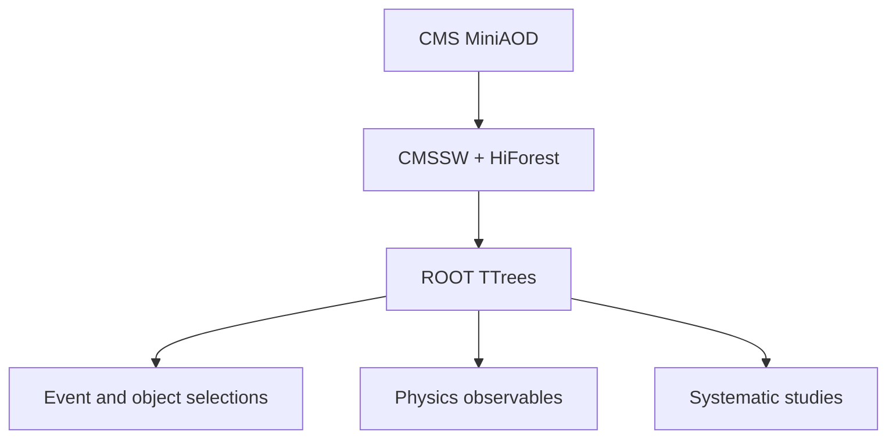

# HiForest Output Format

HiForest transforms CMS MiniAOD into analysis-oriented ROOT files using [[Computing/CMSSW|CMSSW]] producers and analyzers. See [[Computing/HiForest Setup|HiForest Setup]] for the production environment.

The purpose is to separate the relatively expensive event processing stage (object reconstruction, corrections, background subtraction and matching, as configured) from the repeated physics analysis of the resulting ntuples.

## Organization of the output

A HiForest file contains multiple ROOT directories, generally corresponding to CMSSW analyzer labels. These directories contain TTrees with complementary information about the events.

The following schema was observed in the 2023 PbPb example DATA and MC configurations of the `forest_CMSSW_13_2_X` branch, inspected with PyROOT on 2026-11-24.

| Tree path | Information | Use in analysis |
| --- | --- | --- |
| `hiEvtAnalyzer/HiTree` | Event identifiers, vertex, centrality and event properties | Event selection and centrality classification |
| `ggHiNtuplizer/EventTree` | Muons, electrons and photons | Lepton selection and boson reconstruction |
| `akCs4PFJetAnalyzer/t` | Anti-kT R = 0.4 jets with constituent subtraction (CS) | Jet selection, spectra and correlations |
| `akCs4FlowPFJetAnalyzer/t` | R = 0.4 jets with flow-dependent constituent subtraction | Studies of background subtraction |
| `hiFJRhoAnalyzerFinerBins/t` | Background energy density | Underlying event characterization |
| `hltanalysis/HltTree` | Trigger decisions and prescale information | Trigger selection and efficiency studies |
| `skimanalysis/HltTree` | Event filter decisions | Collision event selection |
| `zdcanalyzer/zdcdigi` | Zero Degree Calorimeter digis | Collision characterization |
| `zdcanalyzer/zdcrechit` | ZDC reconstructed hits | Collision characterization |
| `HiGenParticleAna/hi` | Generator particles and ancestry (MC only) | Generator-level studies |
| `HiForestInfo/HiForest` | Production metadata | Provenance |

The two example files each contain 20 entries in every event tree and one entry in the metadata tree. This is a technical smoke test, not a physics sample validation.

## Branches and object multiplicities

A tree entry represents an event in the observed physics trees. Scalar branches store event properties or object counts; array and vector branches store properties of the multiple objects belonging to the event.

Examples:

- Event properties: centrality (`hiBin`) and event identifiers.
- Muons: `nMu`, `muPt`, `muEta`, `muPhi`, `muCharge`, `muMVAIso`.
- Electrons: `nEle`, `elePt`, `eleEta`, `elePhi`, `eleCharge`.
- Jets: `nref`, `jtpt`, `jteta`, `jtphi`.

Objects are associated through their index within a given collection and event. A jet index is not necessarily the same across different jet collections.

## DATA and MC

Most tree paths are common to both configurations, while MC includes additional generator and matching information.

| Tree | DATA branches | MC branches |
| --- | ---: | ---: |
| Event | 60 | 86 |
| Leptons and photons | 328 | 364 |
| CS jets | 58 | 81 |
| FlowCS jets | 58 | 81 |
| Generator particles | — | 25 |

These counts describe the inspected configurations, not a fixed HiForest schema.

Examples of additional MC branches:

- Generator jets: `ngen`, `genpt`, `geneta`, `genphi`, `genm`.
- Jet matching: `refpt`, `refeta`, `refdrjt`, `genmatchindex`.
- Reference partons: `refparton_flavor`, `refparton_pt`.
- Generator particles: `pdg`, `pt`, `eta`, `phi`, `motherIdx`, `daughterIdx` in `HiGenParticleAna/hi`.
- Lepton matching: `mu_genMatchedIndex`, `ele_genMatchedIndex`.
- Generator event information: `pthat`, `weight`, `Ncoll`, `Npart`.

Matching branches support response and efficiency studies, but their precise indexing, unmatched-object conventions and truth definitions must be checked in the relevant analyzer before use. Generator-level information should not automatically be interpreted as an unquenched reference.

Configuration differences can also affect reconstructed quantities. For example, `WTAeta` and `WTAphi` were present in both DATA jet trees but absent in the MC jet trees. Trigger schemas also differed.

## Event association across trees

Analysis often requires combining multiple trees: for example, centrality from the event tree, a Z candidate from the lepton tree, and a recoiling jet from a jet tree.

The example DATA and MC files were checked independently using the full run, luminosity section and event identifiers. The event tree, lepton tree, both jet trees and trigger tree had identical, unique event keys in the same entry order within each file.

Other trees lacked complete event identifiers, so their alignment was not independently established by this check. Equal entry counts alone do not prove synchronization. Verify alignment for each production before joining trees by entry number or using ROOT friend trees; use event-key matching when appropriate.

## Why foresting is useful

- Expensive CMSSW algorithms are run during production rather than on every analysis iteration.
- Ordinary ROOT TTrees can generally be analyzed independently of CMSSW with ROOT, PyROOT or Uproot.
- Reading only the required branches can reduce analysis I/O.
- Multiple analyses can reuse a common production, provided their required objects and observables were saved.
- For Z+jet analyses, lepton four-momenta can be combined into a Z candidate and associated with jets and event centrality to compute observables such as the momentum balance $x_{jZ}=p_T^{\mathrm{jet}}/p_T^Z$ and the azimuthal separation $\Delta\phi_{jZ}$.

Foresting is a lossy transformation: information omitted from the trees cannot generally be recovered from the output alone. New observables requiring unsaved constituents or alternative reconstruction algorithms may require a new production from MiniAOD. Define the physics requirements and check the configuration before large-scale production.

## References

- [HiForest source code](https://github.com/CmsHI/cmssw/tree/forest_CMSSW_13_2_X/HeavyIonsAnalysis)
- [2023 PbPb reference configurations](https://github.com/CmsHI/cmssw/tree/forest_CMSSW_13_2_X/HeavyIonsAnalysis/Configuration/test/Run3_2023_PbPb)
- [ROOT TTree documentation](https://root.cern.ch/doc/master/classTTree.html)
- Local PyROOT schema inspection of the two reference outputs, 2026-11-24. No event-level results or sample files are published here.
