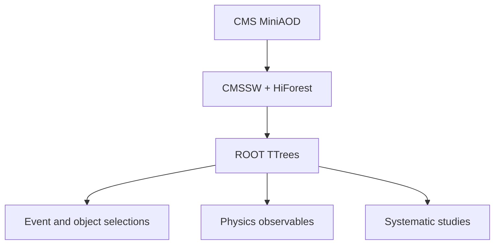
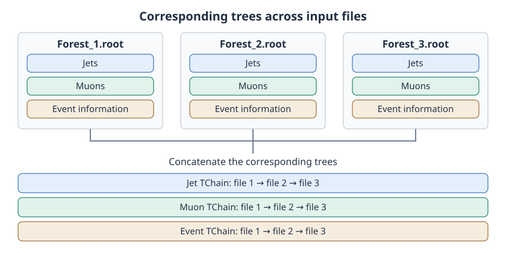
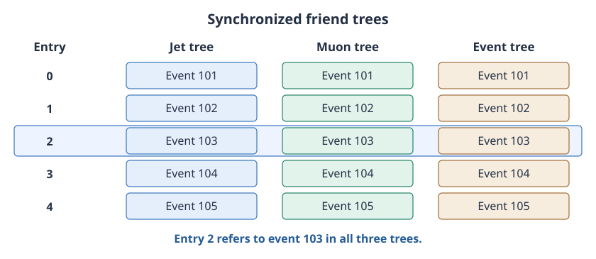
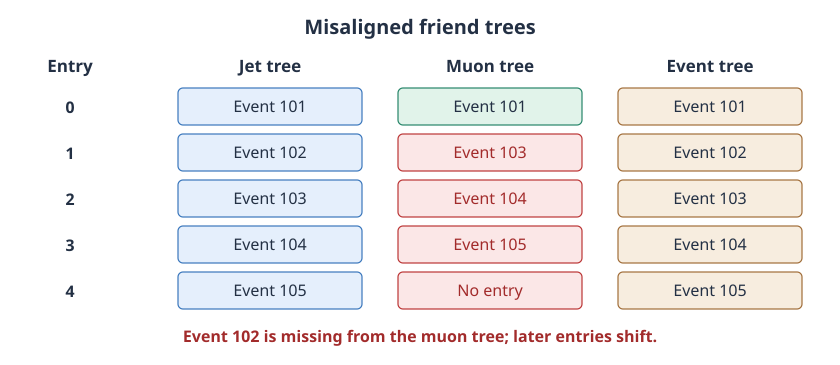

# HiForest Output Format

HiForest transforms [[Computing/CMS MiniAOD|CMS MiniAOD]] into analysis-oriented ROOT files using [[Computing/CMSSW|CMSSW]] producers and analyzers. See [[Computing/HiForest Setup|HiForest Setup]] for the production environment.

Unlike MiniAOD, which retains typed EDM products such as PAT objects and packed PF candidates, HiForest stores selected analysis quantities in simpler ROOT trees. See [[Computing/CMS MiniAOD|CMS MiniAOD]] for the upstream object model, heavy-ion event content and information retained during slimming.

The purpose is to separate the relatively expensive event processing stage (object reconstruction, corrections, background subtraction and matching, as configured) from the repeated physics analysis of the resulting ntuples.



## Organization of the output

A HiForest file contains multiple ROOT directories, generally corresponding to CMSSW analyzer labels. These directories contain TTrees with complementary information about the events.

The following schema was observed in the 2023 PbPb example DATA and MC configurations of the `CmsHI:forest_CMSSW_13_2_X` branch in CMSSW_13_2_4, inspected with PyROOT on 2026-11-24. It documents the original generic HiForest smoke tests, not the newer Trieste analysis branch. The latter uses CMSSW_13_2_13 and dedicated configurations; its output schema must be checked independently (see [[Computing/HiForest Setup|HiForest Setup]]).

| Tree path | Information | Use in analysis |
| --- | --- | --- |
| `hiEvtAnalyzer/HiTree` | Event identifiers, vertex, centrality and event properties | Event selection and centrality classification |
| `ggHiNtuplizer/EventTree` | Muons, electrons and photons | Lepton selection and boson reconstruction |
| `akCs4PFJetAnalyzer/t` | Anti-kT R = 0.4 jets with constituent subtraction (CS) | Jet selection, spectra and correlations |
| `akCs4FlowPFJetAnalyzer/t` | R = 0.4 jets with flow-dependent constituent subtraction | Studies of background subtraction |
| `hiFJRhoAnalyzerFinerBins/t` | Background energy density | Underlying event characterization |
| `hltanalysis/HltTree` | Trigger decisions and prescale information | Trigger selection and efficiency studies |
| `skimanalysis/HltTree` | Event filter decisions | Collision event selection |
| `zdcanalyzer/zdcdigi` | Zero Degree Calorimeter digis | Collision characterization |
| `zdcanalyzer/zdcrechit` | ZDC reconstructed hits | Collision characterization |
| `HiGenParticleAna/hi` | Generator particles and ancestry (MC only) | Generator-level studies |
| `HiForestInfo/HiForest` | Production metadata | Provenance |

The two example files each contain 20 entries in every event tree and one entry in the metadata tree. This is a technical smoke test, not a physics sample validation.

## Branches and object multiplicities

A tree entry represents an event in the observed physics trees. Scalar branches store event properties or object counts; array and vector branches store properties of the multiple objects belonging to the event.

Examples:

- Event properties: centrality (`hiBin`) and event identifiers.
- Muons: `nMu`, `muPt`, `muEta`, `muPhi`, `muCharge`, `muMVAIso`.
- Electrons: `nEle`, `elePt`, `eleEta`, `elePhi`, `eleCharge`.
- Jets: `nref`, `jtpt`, `jteta`, `jtphi`.

Objects are associated through their index within a given collection and event. A jet index is not necessarily the same across different jet collections.

## DATA and MC

Most tree paths are common to both configurations, while MC includes additional generator and matching information.

| Tree | DATA branches | MC branches |
| --- | ---: | ---: |
| Event | 60 | 86 |
| Leptons and photons | 328 | 364 |
| CS jets | 58 | 81 |
| FlowCS jets | 58 | 81 |
| Generator particles | — | 25 |

These counts describe the inspected configurations, not a fixed HiForest schema.

Examples of additional MC branches:

- Generator jets: `ngen`, `genpt`, `geneta`, `genphi`, `genm`.
- Jet matching: `refpt`, `refeta`, `refdrjt`, `genmatchindex`.
- Reference partons: `refparton_flavor`, `refparton_pt`.
- Generator particles: `pdg`, `pt`, `eta`, `phi`, `motherIdx`, `daughterIdx` in `HiGenParticleAna/hi`.
- Lepton matching: `mu_genMatchedIndex`, `ele_genMatchedIndex`.
- Generator event information: `pthat`, `weight`, `Ncoll`, `Npart`.

Matching branches support response and efficiency studies, but their precise indexing, unmatched-object conventions and truth definitions must be checked in the relevant analyzer before use. Generator-level information should not automatically be interpreted as an unquenched reference.

Configuration differences can also affect reconstructed quantities. For example, `WTAeta` and `WTAphi` were present in both DATA jet trees but absent in the MC jet trees. Trigger schemas also differed.

## Event association across trees

Analysis often requires combining multiple trees: for example, centrality from the event tree, a Z candidate from the lepton tree, and a recoiling jet from a jet tree.

The example DATA and MC files were checked independently using the full run, luminosity section and event identifiers. The event tree, lepton tree, both jet trees and trigger tree had identical, unique event keys in the same entry order within each file.

Other trees lacked complete event identifiers, so their alignment was not independently established by this check. Equal entry counts alone do not prove synchronization. Verify alignment for each production before joining trees by entry number or using ROOT friend trees; use event-key matching when appropriate.

## Reading multiple files with ROOT

A `TTree` is a column-oriented dataset. In the event-level HiForest trees, each entry represents a collision event; the corresponding branches contain scalar properties or arrays of reconstructed and simulated objects. Metadata trees are exceptions to this event-level structure.

A `TChain` presents corresponding TTrees in successive ROOT files as one logical tree. For instance, a jet chain concatenates the jet trees from all input files, and an independent muon chain concatenates the corresponding muon trees. Files must be added in the same order to each chain if the chains will subsequently be joined by entry number.



*Figure 1 — TChain concatenates corresponding trees across files. The files and entries in the figure are schematic.*

### Friend trees and the Trieste analysis

The [Trieste Z+jet ROOT macro](https://github.com/cms-ts/cmssw/blob/24818506602796f751e8665cd31aca601e06f1cb/HeavyIonsAnalysis/Configuration/test/analyze/analyze_HI_TTreeReader_ZMM.C#L442-L470) uses the jet chain as its primary tree and attaches the other chains as friends. This source-level inspection refers to CMSSW_13_2_13, not the generic smoke-test schema described above.

| Tree path used by the macro | Role |
| --- | --- |
| `akCs2PFJetAnalyzer/t` (PbPb), `ak2PFJetAnalyzer/t` (pp) | Primary jet chain |
| `muonAnalyzer/MuonTree` | Reconstructed and, in MC, generator muons |
| `hiEvtAnalyzer/HiTree` | Event information |
| `skimanalysis/HltTree` | Collision event filter decisions |
| `hltanalysis/HltTree` | Trigger decisions |
| `hiFJRhoAnalyzerFinerBins/t` (PbPb) | Background energy density |
| `PbPbTracks/trackTree` (PbPb), `ppTracks/trackTree` (pp) | Tracks |

For example, the following simplified C++ code illustrates the technique used by the macro:

```cpp
TChain jets("jets");
TChain muons("muons");
TChain events("events");

for (const auto& file : files) {
    jets.Add((file + "/akCs2PFJetAnalyzer/t").c_str());
    muons.Add((file + "/muonAnalyzer/MuonTree").c_str());
    events.Add((file + "/hiEvtAnalyzer/HiTree").c_str());
}

jets.AddFriend(&muons, "mu");
jets.AddFriend(&events, "ev");

TTreeReader reader(&jets);
TTreeReaderArray<Float_t> jetPt(reader, "jtpt");
TTreeReaderArray<Float_t> muonPt(reader, "mu.recoPt");
TTreeReaderValue<Float_t> vertexZ(reader, "ev.vz");

while (reader.Next()) {
    // Access the jets, muons and vertex of the same event.
}
```

Here `files` is assumed to be a vector of input filenames. The example uses explicit friend aliases for clarity; the original macro uses named chains and mostly unqualified branch names.

In the absence of an explicit event index, ROOT associates the friend entries by position. This is **not an event-key join**: entry 2 of the primary chain corresponds to entry 2 of each friend chain. The association is correct only if the trees contain the same events in the same order.



*Figure 2 — Entry-based association between synchronized event trees.*

If one tree omits an event or changes the order of entries, subsequent entries may refer to different collisions without an immediate error.



*Figure 3 — A missing entry can cause incorrect associations. The last muon entry is absent in this simplified example.*

The [dedicated ZMM data foresting configuration](https://github.com/cms-ts/cmssw/blob/24818506602796f751e8665cd31aca601e06f1cb/HeavyIonsAnalysis/Configuration/test/forest_miniAOD_run3_DATA_ZMM.py#L269-L283) prepends the same skim sequence to the regular CMSSW paths and configures the skim analyzer's superfilter. This is consistent with maintaining a common event selection, but does not independently prove synchronization for a given production.

### Validating synchronization

First inspect the entry counts of the event-level trees. Run this inside an environment with PyROOT available, using a local forest file:

```python
import ROOT

f = ROOT.TFile.Open("HiForestMiniAOD.root", "READ")
if not f or f.IsZombie():
    raise OSError("Cannot open the forest")

for key in f.GetListOfKeys():
    directory = key.ReadObj()
    if not directory.InheritsFrom("TDirectory"):
        continue
    for tree_key in directory.GetListOfKeys():
        tree = tree_key.ReadObj()
        if tree.InheritsFrom("TTree"):
            print(f"{directory.GetName()}/{tree.GetName():25s} "
                  f"{tree.GetEntries():6d}")

f.Close()
```

Equal entry counts are necessary for the event trees used in an entry-based join, but insufficient: compare the full (run, luminosity section, event) identifier sequence wherever the branches exist, check uniqueness where required, and verify the file ordering and counts per file before constructing chains. For trees lacking full identifiers, document the production guarantees and the limitations of the validation. Do not expect the metadata tree to have one entry per event.

If adding a new electron analyzer, verify that its tree receives one entry per accepted event, including events with no selected electrons if those events are part of the forest, and that its entry order is consistent with the other trees.

## Why foresting is useful

- Expensive CMSSW algorithms are run during production rather than on every analysis iteration.
- Ordinary ROOT TTrees can generally be analyzed independently of CMSSW with ROOT, PyROOT or Uproot.
- Reading only the required branches can reduce analysis I/O.
- Multiple analyses can reuse a common production, provided their required objects and observables were saved.
- For Z+jet analyses, lepton four-momenta can be combined into a Z candidate and associated with jets and event centrality to compute observables such as the momentum balance $x_{jZ}=p_T^{\mathrm{jet}}/p_T^Z$ and the azimuthal separation $\Delta\phi_{jZ}$.

Foresting is a lossy transformation: information omitted from the trees cannot generally be recovered from the output alone. New observables requiring unsaved constituents or alternative reconstruction algorithms may require a new production from MiniAOD. Define the physics requirements and check the configuration before large-scale production.

## References

- [HiForest source code](https://github.com/CmsHI/cmssw/tree/forest_CMSSW_13_2_X/HeavyIonsAnalysis)
- [2023 PbPb reference configurations](https://github.com/CmsHI/cmssw/tree/forest_CMSSW_13_2_X/HeavyIonsAnalysis/Configuration/test/Run3_2023_PbPb)
- [ROOT TTree documentation](https://root.cern.ch/doc/master/classTTree.html)
- [ROOT TChain documentation](https://root.cern.ch/doc/master/classTChain.html)
- [ROOT TTreeReader documentation](https://root.cern.ch/doc/master/classTTreeReader.html)
- [Trieste Z+jet analysis source](https://github.com/cms-ts/cmssw/blob/24818506602796f751e8665cd31aca601e06f1cb/HeavyIonsAnalysis/Configuration/test/analyze/analyze_HI_TTreeReader_ZMM.C#L442-L470), pinned revision 2481850.
- Local PyROOT schema inspection of the two reference outputs, 2026-11-24. No event-level results or sample files are published here.
