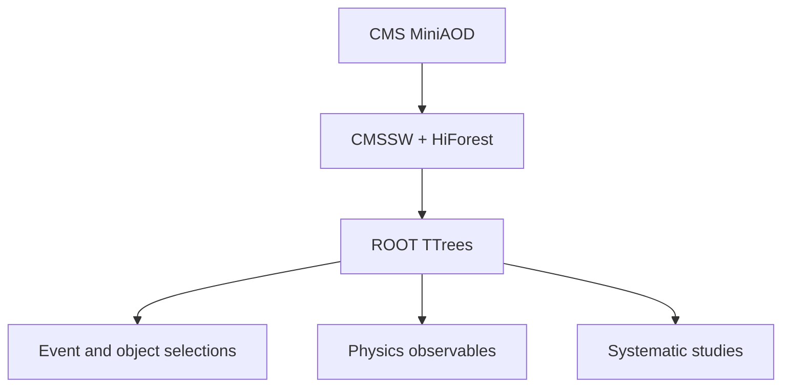
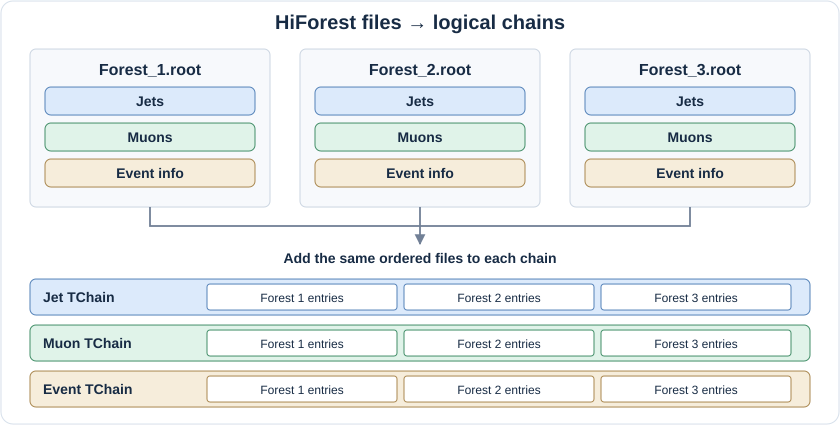
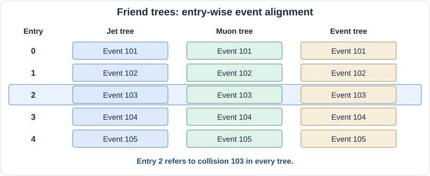
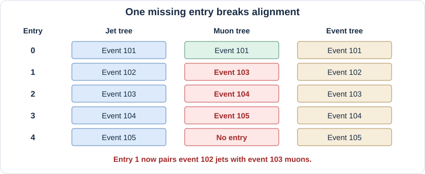

# HiForest Output Format

> [!WARNING] AI-generated content — review pending
> This page was generated with ChatGPT and has not yet been fully reviewed or validated by the author. Its technical explanations, code examples and diagrams should be checked against the original source code and verified before being relied upon.

HiForest transforms [[Computing/CMS MiniAOD|CMS MiniAOD]] into analysis-oriented ROOT files using [[Computing/CMSSW|CMSSW]] producers and analyzers. See [[Computing/HiForest Setup|HiForest Setup]] for the production environment.

Unlike MiniAOD, which retains typed EDM products such as PAT objects and packed PF candidates, HiForest stores selected analysis quantities in simpler ROOT trees. See [[Computing/CMS MiniAOD|CMS MiniAOD]] for the upstream object model, heavy-ion event content and information retained during slimming.

The purpose is to separate the relatively expensive event processing stage (object reconstruction, corrections, background subtraction and matching, as configured) from the repeated physics analysis of the resulting ntuples.



## Organization of the output

A HiForest file contains multiple ROOT directories, generally corresponding to CMSSW analyzer labels. These directories contain TTrees with complementary information about the events.

The following schema was observed in the 2023 PbPb example DATA and MC configurations of the `CmsHI:forest_CMSSW_13_2_X` branch in CMSSW_13_2_4, inspected with PyROOT on 2026-11-24. It documents the original generic HiForest smoke tests, not the newer Trieste analysis branch. The latter uses CMSSW_13_2_13 and dedicated configurations; its output schema must be checked independently (see [[Computing/HiForest Setup|HiForest Setup]]).

| Tree path | Information | Use in analysis |
| --- | --- | --- |
| `hiEvtAnalyzer/HiTree` | Event identifiers, vertex, centrality and event properties | Event selection and centrality classification |
| `ggHiNtuplizer/EventTree` | Muons, electrons and photons | Lepton selection and boson reconstruction |
| `akCs4PFJetAnalyzer/t` | Anti-kT R = 0.4 jets with constituent subtraction (CS) | Jet selection, spectra and correlations |
| `akCs4FlowPFJetAnalyzer/t` | R = 0.4 jets with flow-dependent constituent subtraction | Studies of background subtraction |
| `hiFJRhoAnalyzerFinerBins/t` | Background energy density | Underlying event characterization |
| `hltanalysis/HltTree` | Trigger decisions and prescale information | Trigger selection and efficiency studies |
| `skimanalysis/HltTree` | Event filter decisions | Collision event selection |
| `zdcanalyzer/zdcdigi` | Zero Degree Calorimeter digis | Collision characterization |
| `zdcanalyzer/zdcrechit` | ZDC reconstructed hits | Collision characterization |
| `HiGenParticleAna/hi` | Generator particles and ancestry (MC only) | Generator-level studies |
| `HiForestInfo/HiForest` | Production metadata | Provenance |

The two example files each contain 20 entries in every event tree and one entry in the metadata tree. This is a technical smoke test, not a physics sample validation.

## Branches and object multiplicities

A tree entry represents an event in the observed physics trees. Scalar branches store event properties or object counts; array and vector branches store properties of the multiple objects belonging to the event.

Examples:

- Event properties: centrality (`hiBin`) and event identifiers.
- Muons: `nMu`, `muPt`, `muEta`, `muPhi`, `muCharge`, `muMVAIso`.
- Electrons: `nEle`, `elePt`, `eleEta`, `elePhi`, `eleCharge`.
- Jets: `nref`, `jtpt`, `jteta`, `jtphi`.

Objects are associated through their index within a given collection and event. A jet index is not necessarily the same across different jet collections.

## DATA and MC

Most tree paths are common to both configurations, while MC includes additional generator and matching information.

| Tree | DATA branches | MC branches |
| --- | ---: | ---: |
| Event | 60 | 86 |
| Leptons and photons | 328 | 364 |
| CS jets | 58 | 81 |
| FlowCS jets | 58 | 81 |
| Generator particles | — | 25 |

These counts describe the inspected configurations, not a fixed HiForest schema.

Examples of additional MC branches:

- Generator jets: `ngen`, `genpt`, `geneta`, `genphi`, `genm`.
- Jet matching: `refpt`, `refeta`, `refdrjt`, `genmatchindex`.
- Reference partons: `refparton_flavor`, `refparton_pt`.
- Generator particles: `pdg`, `pt`, `eta`, `phi`, `motherIdx`, `daughterIdx` in `HiGenParticleAna/hi`.
- Lepton matching: `mu_genMatchedIndex`, `ele_genMatchedIndex`.
- Generator event information: `pthat`, `weight`, `Ncoll`, `Npart`.

Matching branches support response and efficiency studies, but their precise indexing, unmatched-object conventions and truth definitions must be checked in the relevant analyzer before use. Generator-level information should not automatically be interpreted as an unquenched reference.

Configuration differences can also affect reconstructed quantities. For example, `WTAeta` and `WTAphi` were present in both DATA jet trees but absent in the MC jet trees. Trigger schemas also differed.

## Event association across trees

Analysis often requires combining multiple trees: for example, centrality from the event tree, a Z candidate from the lepton tree, and a recoiling jet from a jet tree.

The example DATA and MC files were checked independently using the full run, luminosity section and event identifiers. The event tree, lepton tree, both jet trees and trigger tree had identical, unique event keys in the same entry order within each file.

Other trees lacked complete event identifiers, so their alignment was not independently established by this check. Equal entry counts alone do not prove synchronization. Verify alignment for each production before joining trees by entry number or using ROOT friend trees; use event-key matching when appropriate.

## Reading the Trieste Z+jet forests

The Trieste analysis is a standalone C++ ROOT workflow, not a second CMSSW event-processing job. Its [main macro](https://github.com/cms-ts/cmssw/blob/24818506602796f751e8665cd31aca601e06f1cb/HeavyIonsAnalysis/Configuration/test/analyze/analyze_HI_TTreeReader_ZMM.C) reads the trees produced during foresting, applies event and object selections, and fills histograms and response matrices. See [[Computing/Trieste Z+jet Analysis Workflow|Trieste Z+jet Analysis Workflow]] for the processing stages and auxiliary inputs.

The following table describes the **input interface expected by the macro** at the pinned Trieste revision, rather than a new measurement of the output schema. See [lines 442–470](https://github.com/cms-ts/cmssw/blob/24818506602796f751e8665cd31aca601e06f1cb/HeavyIonsAnalysis/Configuration/test/analyze/analyze_HI_TTreeReader_ZMM.C#L442-L470).

| Tree path | Information |
| --- | --- |
| `akCs2PFJetAnalyzer/t` (PbPb) | R = 0.2 constituent-subtracted jets |
| `ak2PFJetAnalyzer/t` (pp) | R = 0.2 jets |
| `muonAnalyzer/MuonTree` | Reconstructed muon kinematics, ID and isolation; generator information in MC |
| `hiEvtAnalyzer/HiTree` | Event identifiers, centrality and vertex information |
| `skimanalysis/HltTree` | Event-filter decisions |
| `hltanalysis/HltTree` | Trigger decisions |
| `hiFJRhoAnalyzerFinerBins/t` (PbPb) | Background energy density |
| `PbPbTracks/trackTree` (PbPb), `ppTracks/trackTree` (pp) | Track information |

The dedicated dimuon configuration schedules `muonAnalyzer`, but not `ggHiNtuplizer`. Therefore the lepton schema differs from the generic smoke-test configuration described above. For example, the macro reads `nReco`, `recoPt`, `recoEta` and `recoPhi` from the muon tree, rather than the generic EGM branches.

The complete sequence of processing stages, script orchestration and preliminary skimming is described separately in [[Computing/Trieste Z+jet Analysis Workflow|Trieste Z+jet Analysis Workflow]].

### TTree, TChain and TTreeReader

A `TTree` is a column-oriented ROOT dataset. A `TChain` presents trees of the same kind from several files as one logical sequence of entries. The chain is a view of the input data; it does not create a new merged ROOT file.



*Figure 1. Concatenation of corresponding trees across input files. Schematic, not measured event counts.*

The analysis adds the same ordered list of files to each chain (simplified from the main macro):

```cpp
TChain data("data");
TChain EventTree("EventTree");
TChain HiTree("HiTree");

for (const auto& file : matched_files) {
    data.Add(TString(file) + "/akCs2PFJetAnalyzer/t");
    EventTree.Add(TString(file) + "/muonAnalyzer/MuonTree");
    HiTree.Add(TString(file) + "/hiEvtAnalyzer/HiTree");
}

data.AddFriend(&EventTree);
data.AddFriend(&HiTree);

TTreeReader reader(&data);
TTreeReaderArray<Float_t> jtpt(reader, "jtpt");
TTreeReaderArray<Float_t> recoPt(reader, "recoPt");
TTreeReaderValue<Float_t> vz(reader, "vz");

while (reader.Next()) {
    // Jet, muon and event information for the same entry.
}
```

The original macro attaches friends by their chain names (e.g. `data.AddFriend("EventTree")`); the example uses the equivalent pointer overload. It omits other trees, selections and corrections. A `TTreeReaderValue` accesses a scalar branch, while a `TTreeReaderArray` accesses a collection of values for the current entry.

### Friend trees and event alignment

A friend tree allows branches from another tree to be read while iterating over the primary tree. In the Trieste macro, no event-key index is explicitly constructed for this operation: it relies on the chains having corresponding entries in the same order.



*Figure 2. Correct entry-wise association. Entry 2 refers to the same illustrative collision in all three trees.*

This is not a relational join on `(run, lumi, event)`. Adding friends does not itself establish that the physical events agree. When a tree misses an entry, subsequent entries may refer to different collisions.



*Figure 3. A missing entry in one tree shifts the association. The final friend entry is absent. Event labels are illustrative.*

In the [2023 PbPb dimuon configuration](https://github.com/cms-ts/cmssw/blob/24818506602796f751e8665cd31aca601e06f1cb/HeavyIonsAnalysis/Configuration/test/forest_miniAOD_run3_DATA_ZMM.py#L231-L283), the same preliminary dimuon skim is prepended to the regular CMSSW paths, and `skimanalysis.superFilters` references the skim path. This is intended to keep the physics trees consistent when events are rejected. It does not remove the need to validate the actual output: analyzers must write entries consistently, and each chain must use the same ordered files.

For a new electron tree, check the following before adding it as a friend:

- Required trees exist in every input file.
- Event-level trees have the same number of entries **within each file**; metadata trees need not.
- Wherever possible, compare full event identifiers (run, luminosity section and event) entry by entry, checking for duplicates within the relevant dataset as well as missing or reordered events.
- If a tree does not store the required identifiers, counts alone cannot establish alignment. Inspect the analyzer and production logic or introduce a suitable event-key-based association.

A minimal read-only inventory in PyROOT:

```python
import ROOT

f = ROOT.TFile.Open("HiForestMiniAOD.root", "READ")
if not f or f.IsZombie():
    raise OSError("Could not open forest")

for key in f.GetListOfKeys():
    directory = key.ReadObj()
    if not directory.InheritsFrom("TDirectory"):
        continue

    for tree_key in directory.GetListOfKeys():
        tree = tree_key.ReadObj()
        if tree.InheritsFrom("TTree"):
            print(f"{directory.GetName()}/{tree.GetName():25s}"
                  f" {tree.GetEntries():6d}")

f.Close()
```

## Why foresting is useful

- Expensive CMSSW algorithms are run during production rather than on every analysis iteration.
- Ordinary ROOT TTrees can generally be analyzed independently of CMSSW with ROOT, PyROOT or Uproot.
- Reading only the required branches can reduce analysis I/O.
- Multiple analyses can reuse a common production, provided their required objects and observables were saved.
- For Z+jet analyses, lepton four-momenta can be combined into a Z candidate and associated with jets and event centrality to compute observables such as the momentum balance $x_{jZ}=p_T^{\mathrm{jet}}/p_T^Z$ and the azimuthal separation $\Delta\phi_{jZ}$.

Foresting is a lossy transformation: information omitted from the trees cannot generally be recovered from the output alone. New observables requiring unsaved constituents or alternative reconstruction algorithms may require a new production from MiniAOD. Define the physics requirements and check the configuration before large-scale production.

## References

- [HiForest source code](https://github.com/CmsHI/cmssw/tree/forest_CMSSW_13_2_X/HeavyIonsAnalysis)
- [2023 PbPb reference configurations](https://github.com/CmsHI/cmssw/tree/forest_CMSSW_13_2_X/HeavyIonsAnalysis/Configuration/test/Run3_2023_PbPb)
- [ROOT TTree documentation](https://root.cern.ch/doc/master/classTTree.html)
- [ROOT TChain documentation](https://root.cern.ch/doc/master/classTChain.html)
- [ROOT TTreeReader documentation](https://root.cern.ch/doc/master/classTTreeReader.html)
- [Trieste analysis macro, pinned revision](https://github.com/cms-ts/cmssw/blob/24818506602796f751e8665cd31aca601e06f1cb/HeavyIonsAnalysis/Configuration/test/analyze/analyze_HI_TTreeReader_ZMM.C)
- [Trieste 2023 PbPb dimuon forest configuration, pinned revision](https://github.com/cms-ts/cmssw/blob/24818506602796f751e8665cd31aca601e06f1cb/HeavyIonsAnalysis/Configuration/test/forest_miniAOD_run3_DATA_ZMM.py)
- Local PyROOT schema inspection of the two reference outputs, 2026-11-24. No event-level results or sample files are published here.
