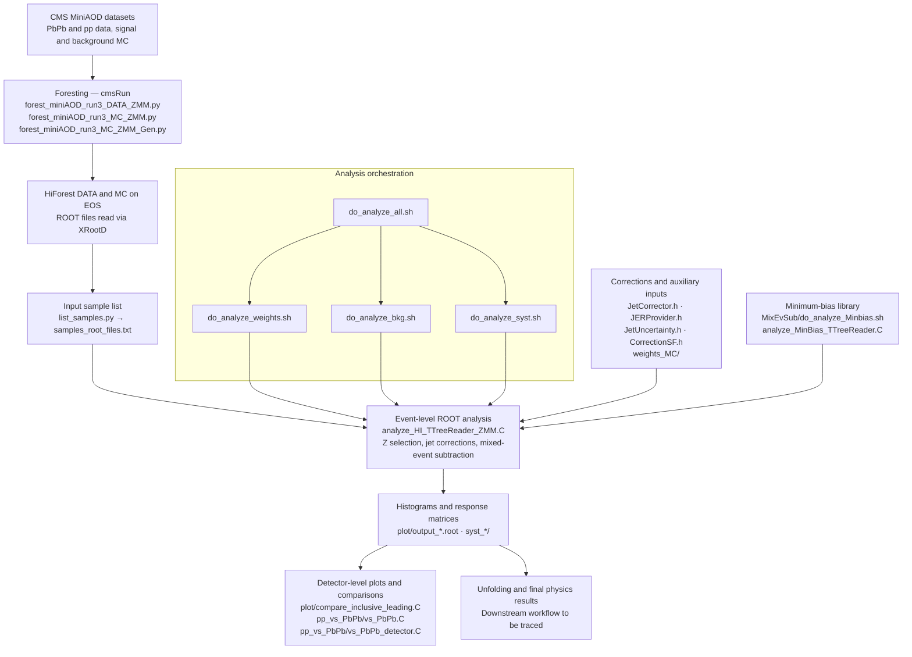

# Trieste Z+jet Analysis Workflow

> [!WARNING] AI-generated content — review pending
> This page was generated with ChatGPT and has not yet been fully reviewed or validated by the author. Its technical explanations, code examples and diagrams should be checked against the original source code and verified before being relied upon.

This note describes the Trieste dimuon Z+jet analysis implemented by Raffaele Delli Gatti, using the reference revision `24818506602796f751e8665cd31aca601e06f1cb`. For environment and workspace setup, see [[Computing/HiForest Setup|HiForest Setup]]. For the input tree schema, TChain and friend-tree alignment, see [[Computing/HiForest Output Format|HiForest Output Format]].

## Analysis workflow

The diagram summarizes the reference implementation at the pinned revision. The foresting stage has already been performed for existing samples. The wrapper scripts invoke the same event-level macro with different samples, weighting phases, kinematic ranges and systematic flags; they do not perform foresting or constitute a downstream plotting stage. For a nominal reduced-sample validation, use the existing auxiliary inputs and invoke the macro directly with a reduced input list.

The minimum-bias library is prepared separately and mixed-event subtraction is performed inside the main macro. The weights wrapper derives the reweighting inputs across repeated invocations. The final response matrices provide inputs for unfolding, but the precise downstream unfolding scripts have not yet been established from this checkout. The foresting configuration names illustrate the PbPb dimuon workflow; the exact configuration of each production must be verified separately.

See the [analysis README](https://github.com/cms-ts/cmssw/blob/24818506602796f751e8665cd31aca601e06f1cb/HeavyIonsAnalysis/Configuration/test/analyze/README), [minimum-bias library README](https://github.com/cms-ts/cmssw/blob/24818506602796f751e8665cd31aca601e06f1cb/HeavyIonsAnalysis/Configuration/test/analyze/MixEvSub/README.md) and [comparison README](https://github.com/cms-ts/cmssw/blob/24818506602796f751e8665cd31aca601e06f1cb/HeavyIonsAnalysis/Configuration/test/analyze/pp_vs_PbPb/README).

## Preliminary skimming versus physics selection

In the ZMM foresting configuration, a single-muon trigger, a vertex selection, PF/global muons with transverse momentum above 15 GeV, and an opposite-sign pair in the 50–130 GeV mass window are required before foresting accepted events. The downstream analysis uses tighter physics selections. This separation reduces data volume but retains a margin for later cuts, control regions and systematic variations.

Similarly, the foresting jet threshold is 15 GeV while the final jet selection uses 30 GeV: jets near the final threshold can migrate across it when energy corrections or resolution smearing are applied.

The [unskimmed MC configuration](https://github.com/cms-ts/cmssw/blob/24818506602796f751e8665cd31aca601e06f1cb/HeavyIonsAnalysis/Configuration/test/forest_miniAOD_run3_MC_ZMM_Gen.py#L213-L265) disables the preliminary dimuon skim. Such samples allow truth-level denominators and selection losses to be studied, including generator-level events that fail reconstruction-level cuts. The configuration used to produce each active signal sample must still be verified; the existence of the unskimmed configuration alone does not establish the provenance of a given dataset.

For a dielectron extension, the key implications are that a muon-triggered skim cannot be undone downstream and that the new electron tree must be synchronized with the existing event and jet trees. The electron reconstruction, identification and isolation details require a separate study.
